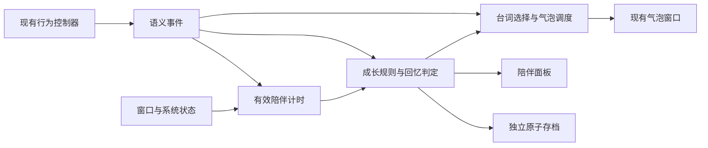

# 草莓猫渐进式陪伴成长设计

设计日期：2026 年 11 月 10 日。适用分支：`skeleton`。首版功能已实现；同日按用户反馈，将日常点击统一改为陪伴短句，取消原单字“喵”气泡。最新自动测试、文案渲染与实机抽查的证据，以及真实多屏、锁屏／休眠等仍未覆盖的环境范围见 [验收记录](COMPANIONSHIP-VALIDATION.md)。留存效果尚未实测。

这一版让小猫在日常相处中逐渐表现出熟悉感：同样的点击、工作和休息，会出现更贴近当前关系的短句；共同经历会留下可以回看的记录。初始成长版本没有新增角色动作、角色贴图或语音；本次按用户需求，为 12 条回忆各增加一幅静态小插画。桌面角色仍沿用当前骨骼资源、行为时序和构建流程。

首版范围为一条长期熟悉度、四个关系阶段、72 条情境短句、12 条永久回忆、一个陪伴面板，以及必要的设置和独立存档。数值是首轮试用参数，留存效果通过实际使用验证。

完整文案和回忆定义见 [陪伴内容表](COMPANIONSHIP-CONTENT.md)，插画主题与素材来源见 [回忆插画说明](MEMORY-ILLUSTRATIONS.md)。

## 产品目标与边界

用户在第一次使用中获得友好回应和第一条记录，几次相伴后发现措辞变化，长期使用后能回看共同经历。小猫始终保持安静、可亲近、允许用户随时离开的性格。

| 目标 | 首版实现方式 |
| --- | --- |
| 短暂使用也有进展 | 主动使用后，累计 1 分钟即可记为一个相伴日 |
| 自然相处产生变化 | 日常与工作共用成长规则，纯日常可以到达全部关系阶段 |
| 减少动作制作 | 关系通过文字、记录和静态回忆插画表达；保留单击喵叫或 Wink 等现有动作 |
| 关系有持续性 | 回忆和已达成阶段永久保留，离开不扣分、不降级 |
| 保持安静 | 工作中不新增主动发言；回忆解锁不逐条弹窗；关系更深不提高发言频率 |
| 成长容易理解 | 面板提供成长说明，桌面不常驻经验条，不显示每日任务或倒计时 |

首版不加入独立等级、饥饿、心情消耗、货币、商店、送礼、连续签到、抽奖、外观成长、AI 对话或全局键鼠监听。当前已有动作从一开始就可用。工作模式、开机启动和鼠标穿透都不成为成长的必要条件。

“好感度”在界面中称为“熟悉度”，避免把小猫的喜欢表现为需要维护的评分。阶段是表达方式的变化，不代表早期小猫会拒绝用户。

## 成长规则

### 主动使用与有效陪伴

主动使用会开启一个 30 分钟的陪伴计时窗口。在这个窗口内，小猫保持可见、系统会话可用，便可累计有效陪伴时间。用户随后可以继续做自己的事，无需反复点击。

下列操作在实际被接受时续期到“当前单调时间加 30 分钟”，续期本身不加分：

| 操作 | 认定位置与限制 |
| --- | --- |
| 日常模式有效单击或双击 | 点击引发的实际回应开始时认定；唤醒和待机收尾后的回应算同一次 |
| 工作休息期间的有效点击 | 休息点击被接受、开始回应链时认定；重复点击不重复产生事件 |
| 工作期间的有效点击 | 确实触发当前基础忙碌回应时认定；只续期可见陪伴，不直接加分、不追加文字或动作 |
| 用户主动选择工作模式 | 模式可用且用户命令被接受时认定；选择已处于的工作模式也可续期，无需重启计时 |
| 用户主动继续工作计时 | 从暂停恢复的明确命令；后台恢复、解锁和自动下一轮不算 |
| 用户主动打开“我们的日常”面板 | 包括托盘入口；已有窗口由用户命令重新激活也可续期 |

悬停、拖拽、设置自动应用、开机启动、自动进入下一轮、自动待机动作、程序自己打开窗口，都不续期。普通菜单展开也不续期。工作中有效点击也能确认主动使用，使记住工作模式并自动启动的用户可以通过日常轻触开始记录；连续点击仍不会直接加分。

窗口使用进程内单调时钟，隐藏、拖拽和暂停不会延长其截止时间。它不跨进程保存；重启后需要新的主动使用。当日已经累计的有效时间仍保留。

| 场景 | 有效陪伴是否累计 | 说明 |
| --- | --- | --- |
| 可见，日常清醒、待机、自动睡眠 | 是 | 让猫睡觉同样是陪伴，无须叫醒它 |
| 可见，工作或休息 | 是 | 两种模式收益相同 |
| 日常暂停自动动作 | 是 | 此开关只暂停自动动作，不表示用户离开 |
| 工作暂停计时 | 是 | 可见陪伴仍成立；工作完成相关的有效工作时间暂停 |
| 菜单、设置或陪伴面板打开 | 是 | 暂停新增气泡，不暂停可见陪伴 |
| 鼠标穿透开启 | 是 | 可用托盘打开面板开启计时窗口 |
| 拖拽中 | 否 | 与当前动作暂停保持一致 |
| 主动隐藏、窗口最小化、锁屏、休眠 | 否 | 恢复后不补算离开期间的时间 |
| 没有有效计时窗口，或成长记录关闭 | 否 | 自启动本身不构成主动相伴 |

所有“是”均以 30 分钟窗口尚未到期为前提。“可见”指窗口未隐藏或最小化、系统会话未锁定；不检测窗口遮挡、视线或其他软件中的活动，也不把记录称为真实专注时长。

### 每日熟悉度

以本地自然日为单位，当天的有效时间可以由多次短会话相加。

| 当日累计有效时间 | 当日累计熟悉度 | 相伴日 |
| --- | ---: | --- |
| 不足 1 分钟 | 0 | 尚未计入 |
| 满 1 分钟 | 3 | 计入 1 天 |
| 满 5 分钟 | 4 | 仍为 1 天 |
| 满 10 分钟 | 5 | 仍为 1 天 |
| 满 20 分钟 | 6 | 仍为 1 天 |

当日记录只保留最多 20 分钟的成长计时时长。每次结算只发放当前档位与已发分数之差。连续点击、反复打开面板、完成更多工作轮次都不会直接加分。

公式中的 `T` 以毫秒计，`I` 为条件满足时取 1，否则取 0：

```text
points(T) = 3 × I(T >= 60_000)
          + I(T >= 300_000)
          + I(T >= 600_000)
          + I(T >= 1_200_000)

新增分数 = points(当日累计有效时间) - 当日已发分数
熟悉度 F = 所有日期账本的已发分数之和
相伴日 D = 已累计至少 60_000 ms 有效时间的日期数
```

到达每日上限后，摸猫回应、情境文字、回忆识别和工作计时照常运行。成长上限不作为弹窗、倒计时或催促内容。

### 阶段门槛与节奏

| ID | 阶段 | 熟悉度门槛 | 相伴日门槛 | 内容变化 |
| --- | --- | ---: | ---: | --- |
| `new` | 初见 | 0 | 0 | 友好、轻巧的回应，建立相伴记录 |
| `familiar` | 熟悉 | 12 | 3 | 认得熟悉的招呼与日常，解锁一组新措辞 |
| `close` | 亲近 | 40 | 8 | 更自然地表达一起工作和休息，解锁一组新措辞 |
| `in_sync` | 默契 | 100 | 21 | 有熟悉的相处方式，解锁一组新措辞，继续积累回忆 |

同时达到两项门槛才晋级。各阶段的 18 条场景短句替换上一阶段对应短句，触发时机保持一致，不提高动画或声音频率。首次进入后三个阶段各获得一条永久回忆。

已达成阶段由阶段回忆保留。当前阶段取“当前规则满足的最高阶段”和“历史已解锁的最高阶段”中的较高者；未来调参数也不撤销用户已经获得的阶段和回忆。

| 每个相伴日的有效时间 | 每日分数 | 到熟悉 | 到亲近 | 到默契 |
| --- | ---: | ---: | ---: | ---: |
| 1 分钟 | 3 | 第 4 个相伴日 | 第 14 个相伴日 | 第 34 个相伴日 |
| 5 分钟 | 4 | 第 3 个相伴日 | 第 10 个相伴日 | 第 25 个相伴日 |
| 10 分钟 | 5 | 第 3 个相伴日 | 第 8 个相伴日 | 第 21 个相伴日 |
| 20 分钟 | 6 | 第 3 个相伴日 | 第 8 个相伴日 | 第 21 个相伴日 |

表中的天数均为累计相伴日，不要求连续；每周使用三天的用户会经历更长的日历时间。阶段上限后继续保留每日记录、台词与累计日数回忆，不出现“已通关”或重新开始的引导。

10 分钟与 20 分钟路径达到阶段的日期相同，是相伴日门槛的作用；较长日子的额外分数可为其他短暂相伴日提供余量。首版阶段内容到默契为止，默契后仍使用该阶段台词和累计回忆，不承诺无限解锁新内容。

### 日期与时间变化

有效时长只从进程内单调时钟计算。自然日只决定账本归属，不用于计算离线奖励。

- 正常跨午夜：将计时间隔按当地午夜分到两天；尚未到期的 30 分钟窗口继续有效。
- 向前改日期：不补记中间日期；新日期必须重新积累真实有效时间才获得分数。
- 回拨到已有日期：继续使用那一天的时间、已发分数和提示额度，不重置领取状态。
- 时区改变或明显校时：把当前采样间隔视为日期切换边界，丢弃跨越不确定边界的最多一个采样间隔，再按新日期继续；不把数小时的墙钟差当成陪伴时间。
- 日期账本不以“历史最大日期”锁定；误设未来再改回不会冻结成长数月。
- 久别回归比较本次主动使用与上次主动使用之前的本地日期，间隔至少 7 日才成立；负间隔按 0 处理。回归没有额外熟悉度。

本地存档不承担抵抗刻意改钟或编辑文件的任务。首版保证正常重启、暂停、跨日和日期来回变化不会重复发放已有日期的奖励。

## 用户体验与交互

### 第一次记录

首次启动没有引导弹窗。小猫按现在的方式运行。用户第一次有效点击时，用初见阶段的短句回应；第一分钟有效陪伴完成后，记录第一个相伴日并解锁 `first_day`。

当天可在安全时机出现一次“第一个相伴日，记下啦。”提示。如果没有安全时机或用户关闭额外文字，只在面板中留下记录。

旧版用户从更新后的首次主动使用开始记录。面板说明“相伴记录从本次更新后开始”，不根据安装时间、文件时间或旧配置推算相处历史。“初见”表示本次成长记录的起始阶段，台词不使用“不认识你”等疏远表达。

### 同一种操作随关系变化

| 触发 | 初见示例 | 熟悉示例 | 亲近示例 | 默契示例 |
| --- | --- | --- | --- | --- |
| 当天首次互动 | 喵，见面啦。 | 你来啦。 | 你来啦，今天也一起待着。 | 喵，你忙，我就在旁边。 |
| 日常点击 | 怎么啦？ | 又来摸我啦。 | 嗯，好舒服。 | 嗯，最喜欢这样了。 |
| 开始工作 | 开始啦，我也准备好了。 | 一起忙一小会儿吧。 | 开工啦，我陪着你。 | 老搭档，开工啦。 |
| 工作到点进入休息 | 到休息时间啦。 | 一起歇会儿吧。 | 到点啦，休息一下。 | 到点啦，歇一小会儿。 |

日常单击仍等概率使用喵叫动作或 Wink，双击仍固定使用喵叫动作；成长不修改动作概率和点击冷却。每次实际被接受的日常单击或双击都用一条陪伴短句回应，不再显示单字“喵”气泡；问候、回归和里程碑可占用同一次回应，不追加第二个气泡。动作进行中或冷却内未被接受的点击仍不叠加回应。

工作开始、进入休息和休息点击的文字替换现有同类文字，沿用原动作链。中途主动退出工作不说“这一段完成了”。文字仅说明应用计时状态，不推断用户实际做完了任务。

### 提示选择与频率

先确定当前行为对应的场景，再选一条文字；不为一个事件连续弹出问候、升级和回忆三条消息。

| 类型 | 触发与预算 |
| --- | --- |
| 工作开始、到点休息、休息点击 | 原本就存在的提示时机；替换文案，不追加气泡 |
| 工作中点击 | 保留“工作呢，别打扰我”的基础回应；可续期陪伴窗口，不直接加分，不加额外文案 |
| 当天首次互动问候或久别回归 | 本地日期内最多 1 条，两者互斥；优先回归 |
| 普通日常点击短句 | 每次实际被接受的日常单击或双击选择一条；不设额外文字概率、等待时间或每日条数上限，仍遵守动作接受条件与点击冷却 |
| 第一个相伴日或阶段达成提示 | 非用户触发的额外提示每日最多 1 条；每条里程碑终身最多显示一次 |
| 其他回忆解锁 | 静默记录，面板中显示“新”；不单独弹气泡 |

当天首次互动候选来自日常点击或休息点击。用户主动开始工作时，用工作开始台词作为当日招呼并消耗当日问候机会；自动开始下一轮不消耗这个机会。打开面板不在猫上弹问候，也不消耗机会。

在休息点击中遇到首次问候或回归时，使用对应的 `rest_short` 文案，保持哈欠后继续睡的节奏。工作开始时发现久别回归，保留当日回归资格，累计有效相伴满 1 分钟后静默记录回忆，当前仍显示工作开始台词。文案清单提供这类短句。

### 冲突与安全展示

优先级从高到低为：

1. 当前工作或休息阶段的必要提示。
2. 用户刚触发的回应，包括问候、回归或普通点击。
3. 待展示的阶段达成提示或首日提示。

同级不排长队。等待唤醒或萤火虫收尾期间不创建气泡展示请求；到 `SpeechCue` 所代表的实际说话时机，才开始计算 2 秒的调度期限。普通互动文字超过期限仍未开始就丢弃，动作照常，不在菜单关闭或恢复可见后补播陈旧回应。问候与一次性里程碑使用后文的先保存、再展示规则，允许极端情况下错过一次提示，避免重复庆祝。

同一次用户回应内的选择顺序为回归、当日问候、待展示阶段提示、普通短句；必要工作阶段提示始终优先。里程碑最多保留一个待展示项：更高阶段覆盖较低阶段或首日提示，全部回忆仍保存。

里程碑只在日常模式的基础 `idle` 姿态、无正在显示的气泡、无待处理点击、无拖拽、无菜单或设置面板，且最近一次主动操作已过去 5 秒时显示。工作模式和睡眠状态不主动显示里程碑，也不主动叫醒猫。用户只用工作模式时，可在休息点击的回应机会用阶段台词替换普通回应；如果与回归相撞，先回归，阶段提示继续等待。

日常有效点击也可用尚未显示的阶段或首日提示替换本次普通短句，不额外追加气泡。首日满一分钟可能恰好遇到默认自动入睡，因此只保证第一下友好回应与首日记录；不保证首次会话一定出现首日纪念气泡。

日常暂停自动动作、工作暂停、系统不可用和成长文字关闭时不启动里程碑。用户打开陪伴面板看到了对应回忆后，待展示项视为已知并移除，避免退出面板再补一次提示。

一个里程碑气泡和一个用户动作相撞时，让位给新动作；被打断的里程碑不重新播放，内容仍可回看。必要阶段提示可覆盖任何低优先级文字。隐藏或锁屏立即隐藏气泡；恢复时丢弃陈旧普通文字，不补播离开期间的提醒。

### 气泡可读性

所有常用短句控制在 14 个可见字符以内，最长不超过 18；超过 14 的条目必须提供不超过 14 字的 `shortText`。宠物高度小于 180 DIP 时使用短版，不能用省略号截断句意。

陪伴文字的展示时长为 `clamp(2200 + 100 × 可见字符数, 3000, 4500)` 毫秒；在界面中不显示这个值。普通日常兜底短句也使用完整文字时长，不沿用旧单字气泡的短时长。文字时长不延长角色动作、工作计时或休息计时，允许气泡在角色回到基础姿态后短暂保留。

继续使用现有透明、不可聚焦、鼠标穿透的气泡窗口。拖拽和工作暂停时维持当前气泡暂停语义；隐藏和锁屏清除过期文字。不同宠物尺寸与 DPI 下至少验证 120、240、480 DIP，避免文字太小或超出屏幕。气泡不承载可点击按钮；关闭、查看等操作放在面板中。

## 永久回忆

首版 12 条回忆的具体标题与正文见 [内容表](COMPANIONSHIP-CONTENT.md)。以下定义判定所需的事实，禁止从文案或动画名字猜测业务事件。

| 类别 | 判定规则 |
| --- | --- |
| 第一日、累计 7／30／60 日 | 复用日期账本认定的相伴日，不另设签到 |
| 熟悉、亲近、默契 | 首次满足对应阶段门槛时解锁 |
| 一起工作 | 工作轮次自然到点，且本轮累计至少 10 分钟在主动使用窗口内、可见、未暂停的工作时间 |
| 一起休息 | 紧接一个符合上一条条件的工作轮次；休息自然结束，且至少 1 分钟在主动使用窗口内、可见、未暂停的休息时间 |
| 桌边微光 | 萤火虫动作从开始到完成一直可见、未锁屏、未拖拽，且全过程在主动使用窗口内 |
| 睡醒见面 | 日常自然入睡后已进入 `Sleep`，由显式点击引发唤醒并实际开始回应；悬停唤醒不算 |
| 又见面了 | 距上次主动使用至少 7 个本地日期，在本次日期首次达到有效相伴 1 分钟时解锁 |

成长每日封顶后，工作、休息、萤火虫等事实仍可识别。工作和休息的有效时长只在 30 分钟主动使用窗口内累计；只要已累计足够资格，随后自然结束时窗口已经到期，仍可解锁对应回忆。萤火虫则要求完整片段都在窗口内。工作回忆不额外加熟悉度、不参与阶段门槛，纯日常使用可以到达“默契”。

工作到点须由明确的 `DeadlineReached` 事件认定。主动取消、退出应用、仅进入 `Exiting` 状态均不算。到点事实已发生后再切换模式，不撤销这次事实。修改工作时长本身不产生完成事件；若现有计时器随后因新期限到点而自然结束，仍以实际有效工作时间是否达到 10 分钟认定。休息按相同原则处理，实际有效休息须达到 1 分钟。

不要求深夜使用、不奖励连续天数、不设置离线归来加分。回忆列表只展示已发生的事情，不展示锁定项、完成率或总数分母。

## 陪伴面板与设置

### 入口与窗口

猫咪右键菜单、系统托盘均新增“我们的日常…”，位于“设置…”附近。设置中也提供同名按钮。单击和双击小猫的原行为保留。

面板标题为“草莓猫 · 我们的日常”。默认 480 × 640 DIP，最小 420 × 480 DIP；空间不足时缩到可见工作区并允许内容滚动。窗口不跟随宠物置顶，不自动弹出；用户明确打开时获得焦点。重复打开复用同一个窗口，Esc 关闭，Tab 顺序符合阅读顺序。

```text
草莓猫 · 我们的日常                         ×

[现有小猫静态预览]  熟悉
                   这个桌角，渐渐熟悉起来。
                   已相伴 4 天

初见 ── 熟悉 ── 亲近 ── 默契
[下一阶段进度]
自然相伴，会慢慢熟悉。
成长说明 ▾

我们的回忆
[抬爪招呼插画]  2026 年 11 月 13 日
                熟悉起来                  新
                熟悉的招呼，留在了这个桌角。

[爪印日记插画]  2026 年 11 月 10 日
                第一个相伴日
                从这一天起，我们开始记下桌边的日常。

记录开始于 2026 年 11 月 10 日
```

示例日期只用于布局说明，实际由本地存档决定。“相伴 X 天”为有效相伴日，不使用安装至今的天数。

阶段进度按熟悉度与相伴日两项的较慢进度显示。计算采用上一个阶段门槛到下一个阶段门槛之间的归一化进度，取两者最小值并限制到 0—1。到达默契后隐藏下一阶段进度，显示“日常还在继续”。

“成长说明”展开后说明：主动使用后会记录一小段可见陪伴；每天 1 分钟开始获得熟悉度，20 分钟达到当日上限；可以查看当前熟悉度、累计相伴日和下一阶段的两项要求。这里提供数字，气泡中不报告加分，也不显示凑时长倒计时。

回忆按解锁时的顺序倒序排列，时间显示当地日期；内部保留 UTC 时间、当时当地日期和递增序号，系统时间回拨不打乱事件顺序。新记录在打开面板实际展示后取消“新”标记，打开列表不自动标记尚未滚动到的记录。

每条已解锁回忆的卡片左侧显示 80 × 80 DIP 小插画，右侧保留日期、标题和正文并允许换行。12 幅图沿用草莓猫形象，用爪印日记、抬爪招呼、工作电脑、休息软垫等场景帮助辨认；图片不含标题文字。插画按现有回忆 ID 关联，已解锁的旧回忆自动显示，无需重新完成条件或迁移存档。图片缺失或损坏时保留完整文字，列表仍可阅读和滚动。

沿用当前设置窗口的暖白背景、粉色浅底和微软雅黑字体。主体文字对比度至少 4.5:1；阶段、错误和新记录都提供文字标识。屏幕阅读器可读取阶段、相伴日、进度说明、回忆标题和日期，不依赖颜色或图标；装饰性插画不重复朗读。面板顶部的小猫预览继续复用当前基础姿态。

### 状态与设置

| 状态或选项 | 界面与行为 |
| --- | --- |
| 尚无相伴日 | “和小猫打个招呼，日常会慢慢记在这里。”；阶段显示初见，不显示虚构认识日期 |
| 记录成长，默认开启 | 关闭后停止计时、加分和解锁，清空当前主动使用窗口；已有阶段与回忆保留 |
| 显示陪伴短句，默认开启 | 关闭后日常点击仅保留原动作，不显示文字；基础工作／休息提示保留，成长可继续，里程碑气泡停止 |
| 记录成长关闭 | 陪伴面板仍可查看历史；陪伴短句停用，日常点击保留动作且不退回单字“喵”，基础工作／休息提示保留。重新开启后由下一次主动使用开始记录 |
| 暂未保存 | 面板顶部显示“这次相伴暂未保存”，提供重试；不抢系统焦点 |
| 已从备份恢复 | 面板显示一次说明，标明备份保存时间，保留恢复后的数据 |
| 存档无法恢复 | 历史区域显示读取失败和重试入口，基础桌宠继续运行；不静默重置 |

“恢复默认设置”只恢复设置，不清除成长。首版不把清空成长放在主操作区；数据无法恢复时才提供明确的“重新开始记录…”操作，须说明会建立新记录，并先保留原文件备份。正常成长数据的管理可留到后续版本。

关闭陪伴短句时，已经解锁的待展示里程碑只留在回忆里；重新开启不批量补播。

关闭成长后不继续追踪使用。重新开启后的首次主动使用只恢复回归比较基准，不依据关闭前的日期判断“好久不见”，也不补播关闭前的回归文字。

## 技术接入

### 模块职责



`BehaviorController` 仍是动作状态的唯一控制者。成长系统不直接调用 `Play`，不修改动作权重、唤醒规则、自动入睡、点击冷却或工作计时。增长计时、内容选择和显示预算均可用假时钟独立验证。

| 模块建议 | 职责 |
| --- | --- |
| `CompanionshipRules`，Core | 日期账本结算、阶段门槛、回忆条件，纯规则 |
| `PresenceTracker`，Core | 30 分钟窗口、可见陪伴分段、午夜拆分；不读取系统 API |
| `CompanionDialogue`，Core | 场景和阶段筛选、随机选择、去重、提示预算 |
| `SpeechCoordinator`，Core | 统一处理基础文字和成长文字的优先级、生命周期，避免双重覆盖 |
| `CompanionStateService`，App | 本地存档、迁移、备份、串行写入与错误状态 |
| `CompanionWindow`，App | 只读呈现关系、回忆和成长说明 |
| 宿主适配，App | 将隐藏、锁屏、暂停、用户菜单命令和时间上下文送入 Core |

将现有 `ShowSpeech` 的直接写入集中到同一调度路径，基础工作提示也通过该路径。App 从调度结果读取气泡文本和播放时间。不得让成长逻辑额外写一次 `_speechText`，与原有喵叫互相覆盖。

### 必需事件

每个业务事件带稳定的进程内事件 ID 和单调时间。延迟回应沿用其请求 ID，去重在行为层完成；存档不无限保留原始鼠标事件。

| 事件 | 产生时机 |
| --- | --- |
| `InteractionCommitted` | 日常点击真正进入回应、休息点击被接受，或工作忙碌点击被接受；含来源、是否从自然睡眠唤醒 |
| `PresenceActivated` | 有效互动或被接受的主动模式、继续工作、面板打开命令；含来源 |
| `WorkRoundStarted` | 实际进入 `work_loop`，创建 `roundId`，记录本轮计划时长 |
| `WorkRoundEnded` | 自然到点或取消，含 `roundId`、结束原因、实际有效工作时间、期间配置变化 |
| `BreakStarted` 与 `BreakEnded` | 首次进入本轮 `sleep_loop` 与自然休息到点／取消；关联上一工作轮次 |
| `IdleActionStarted` 与 `IdleActionCompleted` | 记录萤火虫完整可见区间；隐藏、锁屏、拖拽、实际中断或授权窗口失效会使资格失效 |
| `SpeechCue` | 行为已到适合说话的阶段，区别于工作期限到点等较早发生的事实 |

当前 `StateChanged` 不足以表达这些事实。工作进场也会播放 `meow`，自然结束和取消也会经过 `Exiting`，都不能仅凭状态或片段名字发奖励。

在 `BeginReaction` 等实际接受位置发布互动事件。点击唤醒、等待萤火虫收尾的请求保留身份；单击升级为双击不会形成两次有效互动。拖拽、隐藏或模式切换取消了待回应请求，就不发布已完成互动。

仅暂停后续日常自动动作，不使正在自然收尾的萤火虫经历失效。工作中的忙碌点击从专用接受位置发布，不能把所有 `meow` 或气泡播放都认定为用户点击。

`WorkEndReason` 至少区分 `DeadlineReached`、`UserCancelled`、`Shutdown`。在到点判定处锁定自然结束事实，再执行动画收尾。配置变更是附加事实，不能伪装成新的完整轮次。

所有计时结算先到事件发生时刻，再更新上下文。处理顺序固定为：结算此前区间、应用事件、更新成长与回忆、保存关键变化、选择当前提示。相同时刻产生工作提醒和阶段变化时，工作提醒优先。

### 时钟与性能

继续使用现有 `IClock` 的单调时间；新增可注入的日历时间上下文，提供 UTC 时间、本地日期与时区。两类时钟不可互相代用。

成长计时最多每秒采样一次，不挂入每帧渲染。有效状态改变时额外结算边界。若一次采样间隔为负或超过 5 秒，丢弃该间隔并重建基准，避免 UI 长时间停顿或漏掉挂起通知后补出大段时间。正常午夜拆分只用于可确认时钟连续的短采样间隔。

每日达到 20 分钟后不再增长账本时间，但继续维护授权截止和当前工作／休息的回忆资格。没有有效窗口、没有待显示气泡、没有相关活动时，不为成长维持高频定时器。解析内容、日期账本统计和磁盘写入均不发生在逐帧绘制路径。

## 存档与内容格式

### 独立成长存档

路径为 `%LocalAppData%\DesktopPet.Skeletal\companion-state.json`，与现有 `settings.json` 分离。使用当前单实例约束和单一写入服务。

| 字段 | 用途与约束 |
| --- | --- |
| `schemaVersion` | 数据结构版本，首版为 1 |
| `rulesVersion` | 数值规则版本，首版为 1；规则调整需明确迁移 |
| `stateRevision` | 每次内存状态变更递增；文件保存该快照的修订号，保存回执携带 `savedRevision` |
| `recordingStartedAtUtc` | 首次主动使用的记录起点；没有主动使用时可为空 |
| `recordingStartedLocalDate` | 对应当地日期，展示时不因后来换时区改变 |
| `lastActiveLocalDate` | 最近一次主动使用日期，用于回归判断；判定后再更新 |
| `returnBaselineRequired` | 关闭成长时置真；重新开启后的首次主动使用只重建比较基准，再清除此标志 |
| `days` | 以 `yyyy-MM-dd` 为键的日期账本，保留历史以防日期回拨重复结算 |
| `memories` | ID、解锁 UTC、当地日期、递增解锁序号和已读状态 |
| `pendingMilestoneId` | 最多 1 个待展示首日／阶段提示 |
| `consumedMilestoneIds` | 已显示、被用户查看或明确关闭的里程碑提示 |
| `recentDialogueIds` | 全局最近 8 条及每场景最近 2 条，大小有界 |
| `savedAtUtc` | 保存时间，用于恢复提示，不用于计算陪伴时长 |

每个日期账本保存 `qualifiedPresenceMs`、`pointsGranted`、`companionDayGranted`、`greetingHandled`、`ordinarySpeechCount`、`automaticNoticeUsed`、`returnEligible`。前两项范围分别为 0—1,200,000 和 0—6；日数标志必须与分钟阈值一致。`ordinarySpeechCount` 只保留用于兼容既有存档，不再决定是否显示文字，也不随新点击增长。分数以规则版本验证，加载后从账本求和，不另存一套可能失真的总分和总天数。

`returnEligible` 为可空布尔值：没有发生当天首次主动使用时为未判定，此后按此前的 `lastActiveLocalDate` 固定为真或假。无历史日期时为假，不能把首次使用认定为回归。这样，跨午夜先由计时创建的账本仍可等待当天首次主动使用进行判定。当天累计已经满一分钟后才判定为真时，立即检查并解锁尚未获得的回归回忆。

`returnBaselineRequired` 为真时覆盖上述比较：本次日期资格设为假，更新基准后清除标志，不因为关闭成长的间隔解锁回归。这个标志在设置切换时保存，不要求在关闭成长期间继续记录活动。问候是否出现与回归回忆是否达成分别记录，没有气泡不妨碍合法回归留下回忆。

30 分钟窗口、当前工作轮次和暂停状态都不跨进程恢复。正常工作模式仍按现有行为从新一轮开始。重启后下一次被接受的日常点击可直接显示普通短句，首次问候仍受当天已处理标志约束，不重复问候。

日期账本只保存这些摘要，不保存原始操作轨迹、其他应用活动或键鼠内容。记录增长按天而非按帧；不裁剪可能再次被回拨访问的历史日期。

### 保存和恢复

| 情况 | 处理 |
| --- | --- |
| 普通有效计时 | 合并为最多每 30 秒一个检查点；退出、隐藏、锁屏前尽力保存 |
| 分数档位、相伴日、阶段、回忆、问候额度变化 | 立即请求保存同一完整快照；多个同一事件的变化合并一次 |
| 写入方式 | 同目录写临时文件并 flush，原子替换；保留上一份可验证的有效备份 |
| 写入期间又有新变化 | 单写入队列，仅继续写最新快照；旧任务完成不能将状态回滚 |
| 写入失败 | 内存状态保留并标记未保存，面板提示并可重试；不显示尚未持久化的首次里程碑气泡 |
| 主文件损坏 | 保留损坏文件副本，尝试有效备份；成功恢复后提示一次 |
| 主文件和备份都不可用 | 暂停成长写入并提供重试／打开文件夹；基础桌宠继续运行，不静默重置 |
| 未来版本存档 | 保留原文件且停止写入，提示需要兼容版本；禁止用空数据覆盖 |
| 两个文件都不存在 | 新建空状态，首次主动使用后开始记录；不推算旧使用历史 |

第一次出现里程碑气泡前，先把该提示标记为已消费，取得对应的 `consumptionRevision` 并保存快照。只有收到 `savedRevision >= consumptionRevision` 的成功回执后才允许展示；单写入队列中的旧快照成功不能代替新变化持久化。回执到达后仍需重新检查当前场景、设置、请求期限和用户是否已看过对应回忆，失效则放弃该次气泡。旧回执只更新已保存版本，不能覆盖当前内存状态。

此后若崩溃或展示条件已改变，可能错过一次提示，但回忆已经保存，不会每次重启反复庆祝。普通问候同样先保存当日已处理状态；日常回应保存失败时改用普通点击短句，不显示未持久化的问候或里程碑，也不退回单字“喵”。普通短句在实际开始展示时更新去重历史，不等待磁盘回执；历史随后续检查点保存。

正常保存时，以 30 秒检查点控制尚未达到新分数档位的时间损失；发生写入延迟或失败时，以最后成功保存的快照为恢复边界，不能承诺最多只丢 30 秒。已确认保存的分数、阶段和回忆不因恢复设置或关闭成长而丢失。完全损坏后的恢复最多回到上一有效快照，界面必须说明这个范围。

### 文案数据

台词和回忆定义随应用打包为 UTF-8 内容文件，不写死在状态机中。建议逻辑结构：

```json
{
  "id": "click.familiar.01",
  "scene": "daily_click",
  "stage": "familiar",
  "text": "又来摸我啦。",
  "shortText": "又来摸我啦。",
  "weight": 1
}
```

按场景与当前阶段过滤后，从最近未用的候选中等权抽取。全局最近 8 条优先排除；若候选不足，先放宽全局限制，仍排除同场景最近 2 条；最终至少不重复该场景上一条。每场景只有一条有效内容时允许复用，不影响基本交互。

内容缺失、ID 重复、非法阶段或字符过长应在内容校验中发现。陪伴文字启用时，日常点击优先使用当前阶段的普通点击短句兜底；内容不可用时使用静态短句“我在这儿呢。”，不退回单字“喵”。文字停用时日常点击不显示气泡，工作／休息保留基础提示。静态台词不需要联网或模型调用，不阻止桌宠启动。

回忆插画保存在 `assets/strawberry-cat/memories/{回忆 ID}.png`，发布时复制到 `Assets/strawberry-cat/memories/`。应用以 320 像素宽度解码并缓存冻结后的缩略图，避免每次刷新读取完整原图；运行时不调用 Imagegen。`--check-assets` 同时检查全部回忆对应的图片可加载。生成方式、角色参考和完整提示词见 [回忆插画说明](MEMORY-ILLUSTRATIONS.md)。

## 验收标准

| 编号 | 场景 | 必须成立 |
| --- | --- | --- |
| G01 | 自启动后无人操作 1 小时 | 熟悉度与相伴日均不增加 |
| G02 | 有效点击后分别到 59／60／300／600／1200 秒 | 当日累计分数为 0／3／4／5／6；只有一个相伴日 |
| G03 | 同日多次 30 秒会话 | 在新的主动使用窗口内累加；满 60 秒只结算一次首档 |
| G04 | 一分钟内点击 100 次或不断打开面板 | 无直接点击分数，达到一分钟最多 3 点，现有点击冷却仍成立 |
| G05 | 同日累计超过 20 分钟 | 最多 6 点；日常交互和回忆识别仍可用 |
| G06 | 每日 1／5／10／20 分钟模拟 | 阶段到达日与成长表一致；纯日常和工作结果相同 |
| G07 | 30 分钟窗口到期 | 之后的可见时间不记入成长；新有效操作可续期 |
| G08 | 点击后隐藏、锁屏、休眠再恢复 | 不补离开时间；授权截止不延长；无积压气泡 |
| G09 | 日常暂停与工作暂停 | 可见陪伴可继续；暂停中的工作／休息不累计完成资格 |
| G10 | 跨午夜、日期回拨、时区改变 | 归属正确、已有日期不重复发奖、无负分、无离线补算 |
| G11 | 先误设未来日期，再改回今天 | 今天仍可继续其剩余额度，不被最高日期锁死 |
| I01 | 单击、双击、点击唤醒、待机中点击 | 原动作规则不变，同一回应最多一个有效互动事件 |
| I02 | 拖拽或隐藏取消待回应点击 | 不发布有效互动，不解锁点击唤醒回忆 |
| W01 | 工作设为 1 ms，自动循环很多次 | 无额外熟悉度，无工作或休息回忆 |
| W02 | 自然到点、提前取消、到点后切模式 | 分别为自然完成、取消、仍保留已发生的自然完成事实 |
| W03 | 改短工作时长 | 配置修改不发奖励；自然到点后仍须满足 10 分钟有效工作 |
| W04 | 工作自动下一轮或重启恢复工作 | 不自动续期主动使用窗口，不重放旧轮次回忆 |
| W05 | 工作模式自启动后用户明确点击 | 保留忙碌回应并续期陪伴窗口；没有点击直接分数或额外文案 |
| W06 | 有效工作／休息时间满足，但结束时窗口已过期 | 自然结束仍可解锁对应回忆，默认 25／5 分钟流程成立 |
| C01 | 工作到点与阶段达成同时发生 | 先显示休息提示，阶段回忆已保存；不追加动作 |
| C02 | 久别回归、每日问候、阶段提示相撞 | 当前触碰仅一条回应，按规则消费或保留待展示项 |
| C03 | 连续有效日常点击、同日重启及旧存档已用满文字计数 | 每次被接受的点击都有新短句，按阶段去重，不回退单字“喵”；动作冷却与成长规则不变 |
| C04 | 用户看过阶段回忆或关闭陪伴短句 | 不再补播对应待展示提示 |
| C05 | 120／240／480 DIP 与不同 DPI | 长短文案可读、不裁切、不抢焦点、不挡鼠标 |
| P01 | 保存失败后继续使用并重试 | 内存进展保留，错误可见，保存成功后状态一致 |
| P02 | 主文件损坏、备份有效；两者均坏 | 分别恢复并提示、停止覆盖并提供恢复入口 |
| P03 | 同日重启、恢复默认、关闭再开启成长 | 已存分数、额度、回忆不重复不丢失 |
| P04 | 第一次升级保存后立刻崩溃 | 阶段与回忆存在；最多错过气泡，不重复庆祝 |
| P05 | 内容缺失、未来存档版本 | 基础桌宠可运行；不破坏现有数据 |
| P06 | 旧保存回执晚到，提示消费尚未保存 | 不据旧回执展示一次性提示，不回滚内存状态 |
| P07 | 关闭成长一周，期间照常使用，再开启 | 首次主动使用只重建基准，不误报久别回归 |
| U01 | 鼠标穿透、猫隐藏、面板已打开 | 托盘仍可进入；面板单实例；隐藏时打开面板不强制显示猫 |

其中 G06 使用纯规则模拟，其他核心规则使用假单调时钟和假日历时钟。文件恢复与原子写入覆盖真实临时目录；气泡和窗口用现有 WPF 测试及桌面人工验收。沿用当前动作、工作模式、点击和保存的回归测试，不重新制作或恢复逐帧素材。

## 实施顺序与试用

| 顺序 | 可交付范围 | 完成条件 |
| --- | --- | --- |
| 1 | 语义事件、有效陪伴、日期账本、独立存档 | 成长路径和异常时间测试通过，原有动作测试通过 |
| 2 | 阶段短句与统一气泡调度 | 六类场景完整，优先级和去重成立，三个尺寸可读 |
| 3 | 回忆判定、陪伴面板与设置 | 12 条回忆有明确事件来源，穿透和恢复场景可用 |
| 4 | 小范围试用与参数调整 | 先观察前两周，再覆盖进入默契后的两周，区分内容不足、打扰和成长速度问题 |

上表第 1—3 项为本次功能实现范围；第 4 项为发布后的产品验证计划，尚未开展，不作为已取得留存提升的证据。尚未联系或邀请试用者。

后续可邀请约 10—20 位愿意反馈的同学试用，包含日常陪伴和工作模式用户。通过面板记录与手工回访观察，不为首版加入联网遥测。

重点看第 7 天和第 14 天是否仍有主动使用、用户能否举出一句感觉“更熟悉”的回应、是否打开回忆、是否因气泡打扰而关闭文字。自动启动和后台运行时长不能单独当作留存。若比较旧版与新版，保持观察口径一致；小样本结果用于寻找问题，不宣称统计显著的留存提升。

另外至少保留一组用户进入默契后继续观察两周，重点验证固定台词池与第 30、60 个相伴日回忆是否仍有价值。前两周数据只能评价早期成长，不能代表最高阶段后的长期体验。

若用户未察觉阶段变化，先调整文案和阶段提示；若短句频繁被关闭，先降低出现频率；若经常只相伴几分钟的用户进展太慢，再调整门槛。保持单一熟悉度与永久关系，不通过增加惩罚或每日任务补留存。

## 参考与当前实现依据

产品机制参考：[VPet 官方养成说明](https://wiki.exlb.net/zh-hant/vpet/develop)、[VPet 按状态筛选文本的源码](https://github.com/LorisYounger/VPet/blob/main/VPet-Simulator.Windows.Interface/Mod/ICheckText.cs)、[Chill with You 官方介绍](https://store.steampowered.com/app/3548580/Chill_with_You_Lo-Fi_Story/)、[伪春菜角色按好感度改变触碰回应的作者说明](https://blog.electricsea.io/entry/2024/08/29/191807)。这些来源支持相应机制的存在；本设计的阈值、频率和文案为 TablePet 的首版选择。

实现接入主要对应 `src/TablePet.Core/BehaviorFacts.cs`、`BehaviorController.cs`、`WorkMode.cs` 和 `Companionship/`，以及 `src/TablePet.App/Services/CompanionSession.cs`、`CompanionStateService.cs`、`CompanionWindow.xaml`、`PetWindow.xaml.cs`、`SettingsWindow.xaml`、`Services/TrayService.cs`。气泡沿用 `SpeechBubbleVisual.cs` 与 `SpeechBubbleWindow.cs`；设置仍由 `Services/SettingsService.cs` 管理。现有交互说明见 [设置说明](SETTINGS.md)。
